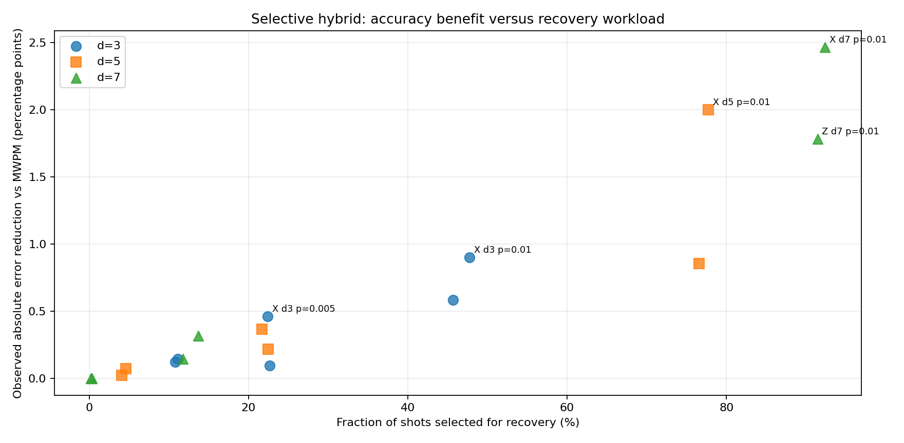

# QEC Decoder Lab

**A reproducible Python project for building, testing, and benchmarking quantum error-correction decoders.**

QEC Decoder Lab studies rotated surface-code memory experiments with [Stim](https://github.com/quantumlib/Stim), uses [PyMatching](https://github.com/oscarhiggott/PyMatching) for minimum-weight perfect matching (MWPM), and implements experimental Bayesian-inspired fault recovery. It includes exact logical-MAP checks on small detector models, matched-shot comparisons, and evidence-preserving validation pipelines.

This is an **engineering project with a research direction**, not a claim of a newly proven optimal decoder or hardware-ready real-time correction. Both positive and negative results are documented.

## What is implemented

| Component | Scope |
|---|---|
| Simulation | Stim rotated surface-code X/Z memories, circuit-level and simplified noise |
| Decoder baselines | PyMatching MWPM; original loopy belief propagation (BP) |
| Experimental methods | Syndrome-consistent BP-guided recovery; selective MWPM/recovery hybrid |
| Acceleration | Vectorized sum-product BP; optional compiled kernels and experimental min-sum |
| Correctness checks | Exact logical-MAP on small models, syndrome consistency, prediction regression |
| Measurement | Identical-shot accuracy, McNemar tests with Holm correction, latency and process memory |
| Reproducibility | Frozen study protocols, source hashes, archived inputs and predictions, integrity audits |

## Measured results

The figures below are from separate, previously completed local simulation studies. The detailed evidence review, limitations, and provenance are in [Results and limitations](docs/RESULTS_AND_LIMITATIONS.md) and [Evidence and provenance](docs/EVIDENCE.md).

| Study | Findings | Important qualification |
|---|---|---|
| 72-case development comparison | Original BP: **780** errors versus MWPM: **180**, on 18,432 paired shots | Original BP underperformed; development data |
| Optimized recovery, 18 held-out cases | Recovery: **2,214** errors versus MWPM: **2,717**, on 73,728 paired shots; **7/18** Holm-significant improvements | Frozen simulated experiment; implementation was about **3,401×** slower by the reported median per-case ratio |
| Selective hybrid, 18 new held-out cases | Hybrid: **2,208** errors versus MWPM: **2,641**, on 73,728 paired shots; **5/18** Holm-significant improvements | Recovery invoked on **32.1%** of shots; median per-case slowdown still about **1,202×** |
| PyMatching paper-protocol benchmark | **Nine** distances, 90,000 shots, 63 timing trials | Cross-machine trend comparison; not a full three-decoder figure reproduction |

The hybrid results are **case-specific evidence from simulated circuit-level noise**, not proof of general superiority. The hybrid and full-recovery speed ratios came from different benchmark settings, so the difference between them is **not** a controlled speedup measurement.



<sub>Summary from the independently audited frozen hybrid study. The companion [18-case CSV](docs/data/hybrid_18_case_summary.csv) is a compact derived summary, not a substitute for the raw archived shots.</sub>

## Quick start

Use an environment with supported Python and installed core packages. On Homebrew-managed Python, follow the safe package-install guidance rather than overriding system package protections.

```bash
python3 -m pip install -e '.[dev,plots]'
PYTHON=python3 bash scripts/shell/RUN_TESTS.sh
```

This repository includes multiple experimental pipelines. For a low-cost end-to-end check, **do not immediately launch the full 18-case study**:

```bash
OUTPUT_DIR=outputs/hybrid_smoke MODE=smoke SHOTS=64 PAIRED_SHOTS=16 \
  PYTHON=python3 bash scripts/shell/RUN_HYBRID_HELDOUT.sh
```

Read [Getting started](docs/GETTING_STARTED.md), [Outputs and artifacts](docs/OUTPUTS_AND_ARTIFACTS.md), and [Validation](docs/VALIDATION.md) before generating a new frozen study. A new algorithm variant needs a **new protocol and new independent shots**. Historical held-out observations used in tuning are thereafter development data.

## Project status and next milestone

**Status: active development.** The decoder implementations, tests, documentation and historical simulation evidence are available for inspection. The remaining priority is controlled same-shot performance attribution and reducing recovery latency; this project does **not** demonstrate real-time QEC decoding. GitHub Actions results should be checked against their experiment-specific audit criteria.

The next priority is a controlled, **same-shot three-way performance study** of MWPM, full recovery and the selective hybrid. It will quantify the benefit of gating without conflating batch sizes or sampling runs. Further work targets the expensive BP and GF(2) operations and more selective gates at high noise.

See the [roadmap with acceptance criteria](docs/ROADMAP.md) and [performance-engineering analysis](docs/PERFORMANCE_ENGINEERING.md).

## Repository map

- `src/qec_decoder_lab/`: decoder implementations, experiment runners, analysis and audits
- `scripts/shell/`: local experiment entry points and evidence packaging
- `tests/`: numerical, integration, regression and artifact-integrity checks
- `data/`: example calibration inputs and attributed published reference numbers
- `docs/`: methods, results, performance analysis, roadmap, evidence and contribution guide
- `.github/workflows/`: PR checks and manually triggered large studies

Generated experiment files are written under local `outputs/` and ignored by Git. GitHub Actions uploads selected results as downloadable, time-limited **run artifacts**, not commits. See [where to find outputs and download artifacts](docs/OUTPUTS_AND_ARTIFACTS.md). Preserve large raw evidence archives separately with checksums and source revision identifiers; commit only small, attributed summaries and figures. Scientific claims are limited to the saved evidence and the stated methods.

[Methods](docs/METHODS.md) · [Results](docs/RESULTS_AND_LIMITATIONS.md) · [Outputs and artifacts](docs/OUTPUTS_AND_ARTIFACTS.md) · [Roadmap](docs/ROADMAP.md) · [Contributing](docs/CONTRIBUTING.md)
