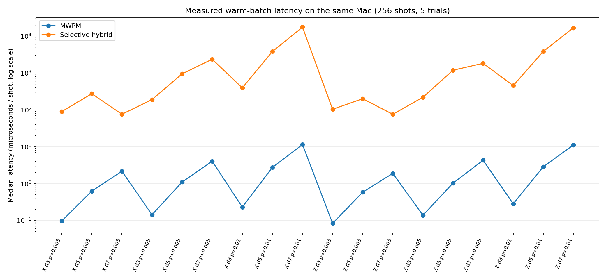

# Decoder performance engineering

The project includes fast MWPM decoding (PyMatching), a slower experimental
BP-guided syndrome-consistent fault recovery, and a **selective hybrid** that
uses MWPM on every shot and calls recovery only on specified detector patterns.
These are three distinct systems, not implementations of one identical decoder.

## Why did recovery run about 3,401x slower?

The 3,401x figure came from the **median per-case speed ratio** in an earlier
18-case, 64-shot, same-machine study. It should not be confused with a CPU
instruction-count ratio or an inherent algorithmic complexity bound.

- PyMatching performs highly optimized C++ **batch** decoding on graph-based
  matching problems. Python recovery does dense BP message-passing and a
  fresh BP-ordered GF(2) elimination plus refinement for each unique syndrome.
- The latter uses up to 20 BP iterations and hundreds to thousands of error
  mechanisms. Shot counts, code distance, detector count, noise profile, and
  unique-syndrome rates influence the latency.
- The prior study used warmed 64-shot batches and fresh processes. Construction
  was excluded from timing; process RSS included runtimes and libraries. The
  measurements do **not** compare equally optimized algorithms.
- Native compilation alone cannot erase a three-order-of-magnitude gap.
  A different inference/selection strategy or a substantially better native
  algorithm is needed for practical low-latency QEC.

Amdahl-style estimate for a selective hybrid:

`mean T_hybrid ~= mean T_MWPM + E[ I(gate) * T_recovery | case ] + gate overhead`

For example, even if recovery is 4,500x slower than MWPM, processing 20% of
shots with recovery leaves roughly 900x overhead before gating costs. Faster
*average* decoding is therefore not the same as matching MWPM latency.

## Component breakdown on inspected development shots

The first instrumentation pass measured approximate per-shot medians:

| Case | BP message updates | BP-ordered basis/solve | Other work |
|---|---:|---:|---|
| X, d=3, p=0.005 | 1.34 ms | 0.06 ms | prior basis and refinement |
| X, d=5, p=0.01 | 5.74 ms | 1.58 ms | prior basis and refinement |
| X, d=7, p=0.01 | 16.82 ms | 7.61 ms | prior basis and refinement |
| Z, d=7, p=0.01 | 17.76 ms | 9.33 ms | prior basis and refinement |

These components are **instrumentation timings**, not isolated process
benchmarks, and depend on this environment. The cost of the BP-ordered basis
increases substantially with detector count.

## Ablation: does the expensive BP guidance help?

The development-only ablation computes a consistent set of candidates on the
**same** archived shots:

- `prior_raw`: solve the detector constraints using only prior fault weights.
- `prior_refined`: apply local syndrome-preserving refinement to prior recovery.
- `bp_guided_raw`: BP marginal reliability orders the elimination basis.
- `bp_guided_refined`: apply local refinement to that BP-guided solution.
- `full`: select the lower-prior-cost candidate between refined BP and refined prior.

On the initial six-case, 24-shot-per-case development check, removing BP
reduced time but frequently increased logical errors, especially for d=5/7.
For example X/d7/p=0.01 had 9 prior-refined errors versus 3 full-recovery
errors in 24 shots. The sample is far too small to make a population claim.
**Therefore there is currently no justification for removing BP altogether.**

Run the full ablation on the previously saved archive with
`RUN_PERFORMANCE_ABLATION.sh`. All outputs are labeled DEVELOPMENT_ONLY.

## Compiled acceleration and iteration variants

The optional `numba` acceleration includes:

- `check_update=compiled`: compiled sum-product check/variable updates using
  linear-time prefix/suffix parity products; numerically cross-checked against
  the NumPy sum-product implementation, including zero messages.
- `basis_update=compiled`: bit-packed GF(2) pivot construction, preserving the
  original Python pivot vectors and recovered fault sets on tested models.
- `check_update=minsum`: a **different algorithm**, normalized min-sum BP,
  implemented in compiled loops. May change predictions and accuracy.
- Smaller iteration budgets, e.g. 5 or 10 instead of 20, are also **algorithmic
  changes**, not guaranteed output-preserving accelerations.

A development benchmark on six historical circuit-level cases (24 shots/case,
2 timing repetitions, Linux Python 3.13) measured:

| X-memory case | NumPy 20 iters | Compiled sum-product 20 iters | Compiled 5 iters | Min-sum 5 iters |
|---|---:|---:|---:|---:|
| d=3, p=.005 | 982 µs | 492 µs | 278 µs | 240 µs |
| d=5, p=.01 | 6,807 µs | 4,540 µs | 2,151 µs | 1,461 µs |
| d=7, p=.01 | 24,749 µs | 19,796 µs | 10,760 µs | 8,462 µs |

The 20-iteration sum-product implementations reproduced all archived logical
predictions across this benchmark. The shortened/approximate variants **did
not always preserve predictions or logical error counts** and cannot be
reclassified as validated accuracy improvements. Small samples and noisy
wall-clock measurements preclude general speed claims. There is no guarantee
that this container's CPU timings reproduce on macOS.

Install optional JIT support with `python -m pip install -e '.[accelerated]'`
with an interpreter for which compatible Numba wheels exist. The regular
NumPy implementation remains usable without Numba, including on Python 3.14
where wheel compatibility must be checked before attempting an install.

## Selective hybrid: measured accuracy versus compute

The 10% active-detector threshold was chosen on **development** shots. An independent subsequent 18-case **frozen hybrid study has now completed**. On 73,728 matched simulated shots:

- MWPM made **2,641** logical errors and hybrid made **2,208**. Five of 18 case comparisons passed the prespecified Holm correction, all favouring hybrid; this is not a universal performance claim.
- **23,646 shots (32.07%)** were selected for the recovery path. Selection rates were 5.2%, 19.1% and 71.9% by physical error probability 0.003, 0.005 and 0.01, respectively. In some d=7, p=0.01 cases selection exceeded 90%.
- The **median of 18 per-case warmed-batch hybrid-to-MWPM latency ratios** was **1,202×**. Median hybrid latency across case medians was about 423.3 microseconds/shot, versus about 1.057 microseconds/shot for MWPM, but the quotient of those medians is **not** the median of the per-case ratios.
- Hybrid process peak RSS averaged about **21.0 MiB more** than MWPM across measured cases. This is process memory, not a separately measured decoder heap footprint.

The frozen study used warmed 256-shot timing batches and five timing trials per case. The full-recovery **3,401×** ratio came from a different earlier 64-shot experiment. **Their difference is not a measured 3,401× to 1,202× performance improvement under controlled conditions.** There is also no full-recovery prediction record for the new hybrid shots, preventing a controlled three-way accuracy comparison.

### Historical retrospective gate exploration

The following **development-only** threshold sweep used a different prior optimized held-out archive. It is preserved to explain the gate design, not to claim fresh validation:

| Active-detector threshold | Fraction sent to recovery | Observed full-recovery error reduction retained |
|---:|---:|---:|
| 0.05 | 64.9% | 99.8% |
| 0.08 | 46.7% | 96.8% |
| 0.10 | 32.5% | 91.3% |
| 0.12 | 24.9% | 81.1% |
| 0.15 | 13.2% | 50.7% |

A historical latency *estimate* for the 10% gate was about 2,782 microseconds per shot for hybrid versus 7,709 microseconds for full recovery. That estimate is now **superseded by the separately measured hybrid timings for practical reporting**, but remains an example of how gating workload influences expected cost. Different inputs and timing scopes mean these estimates cannot be used for a controlled speedup.

## Why the 1,202× gap is still the main engineering blocker

The current gate pays for an MWPM pass **plus** BP-guided recovery on all selected shots. The gate is least selective when the detector patterns are hardest; reducing the number of recovery calls does not make each call fast. The earlier component profiling found expensive BP updates and syndrome-specific GF(2) basis construction at d=7. We do not yet have a controlled comparison of full recovery and hybrid on **identical new batches**.

**Next measurement:** run the same-shot three-way benchmark, separating warm/cold construction, gate inference, BP, basis/solve, refinement and native/Python boundaries. Fix batch size, machine, core setup, repetitions and input hashes; archive all raw trial durations and predictions. This is a planned milestone, **not** implemented as a newly validated study. See [Roadmap](ROADMAP.md).

## Candidate optimizations, not verified results

1. Profile the compiled BP and bit-packed GF(2) paths in steady state, accounting for JIT compile and warmup time separately.
2. Reduce per-syndrome basis rebuilding with caches or localized decomposition; test prediction preservation and memory pressure.
3. Explore bounded-cost local recovery and a cheaper confidence/ambiguity gate. Any new threshold is tuned on development data only and must receive **new frozen independent validation**.
4. Compare normalized min-sum, fewer BP iterations and other accuracy-changing kernels in separate matched studies; do not promote them as equivalent to the 20-iteration reference.
5. Compare against stronger published decoding baselines and broader noise families with matched conditions before making novelty or state-of-the-art claims.

A complete artifact audit verifies arithmetic, hashes and archived predictions; it is not independent quantum hardware validation. See [Results](RESULTS_AND_LIMITATIONS.md), [Methods](METHODS.md), [Validation](VALIDATION.md) and [Evidence](EVIDENCE.md).
