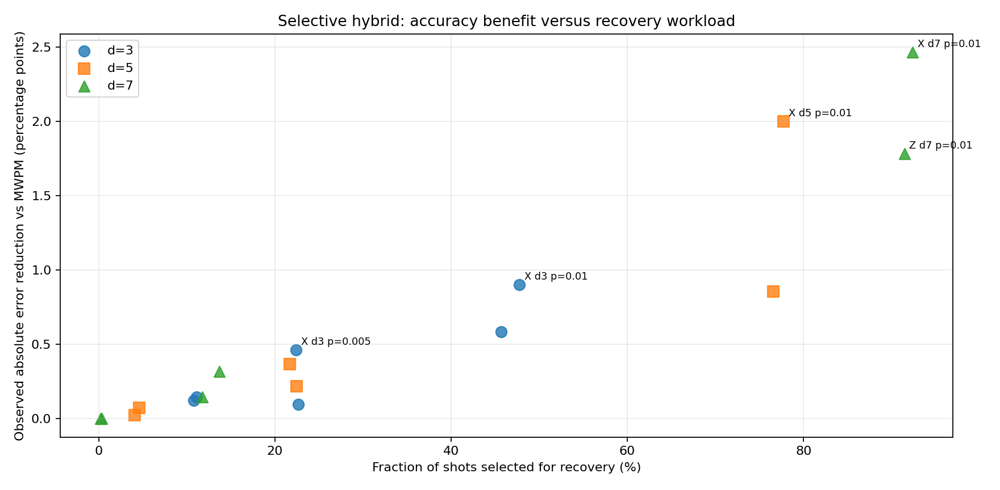
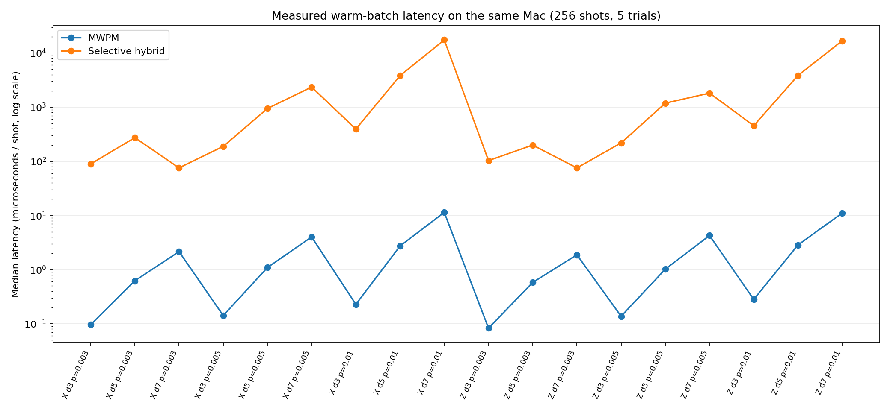

# Results and limitations

This page reports **observations from archived local simulations**, not novel-hardware measurements. All comparisons use logical outcomes from the same shots within each study. Source and protocol evidence for each study is preserved separately; see [Evidence and provenance](EVIDENCE.md). Independent review checked archived hashes and statistical accounting but did **not** independently rerun Stim/PyMatching or reproduce hardware measurements.

## Main result: frozen 18-case selective hybrid study

The study locked a 10% active-detector fraction gate before sampling fresh shots. It covered X/Z memory, code distances 3/5/7 and physical error probabilities 0.003/0.005/0.01 (18 cases). Each case included 25,000 MWPM shots and a 4,096-shot common subset for MWPM versus hybrid.

| Metric | Verified observation |
|---|---:|
| All sampled shots | 450,000 |
| Paired shots | 73,728 |
| MWPM failures, paired | 2,641 (3.582%) |
| Hybrid failures, paired | 2,208 (2.995%) |
| Fewer hybrid failures, descriptively | 433 (16.4% relative) |
| Cases with fewer / equal / more hybrid errors | 16 / 2 / 0 |
| Statistically significant cases after Holm correction | 5 of 18, favouring hybrid |
| Shots routed to recovery | 23,646 (32.07%) |
| Median per-case hybrid/MWPM timing ratio | 1,202× (implementation-level) |

The five corrected-significant cases are:

| Memory | Distance | Physical p | MWPM failures | Hybrid failures | Holm-adjusted p |
|---|---:|---:|---:|---:|---:|
| X | 3 | 0.005 | 78 | 59 | 0.035885 |
| X | 3 | 0.010 | 271 | 234 | 0.014745 |
| X | 5 | 0.010 | 376 | 294 | 0.00000740 |
| X | 7 | 0.010 | 507 | 406 | 0.0000451 |
| Z | 7 | 0.010 | 427 | 354 | 0.003203 |

The statistical test was two-sided exact McNemar on each pair of predictions, followed by Holm correction over the 18 declared cases. The combined 433-failure difference is **descriptive across heterogeneous operating points**, not a universal effect or an independently valid single pooled p-value. Negative and non-significant cases remain in the [full compact case table](data/hybrid_18_case_summary.csv).

### Gate and computational cost

MWPM decodes every shot; hybrid additionally runs BP-guided recovery on detector-activity-selected shots. The measured recovery fraction varies strongly with noise: **5.2% at p=0.003, 19.1% at p=0.005 and 71.9% at p=0.01**. Some d=7, p=0.01 cases select more than 90%.

The observed median of 18 **per-case latency ratios** was **1,202× slower** than MWPM (range about 35× to 1,721×). The timing used warmed 256-shot batches and five repeats per method; process peak RSS averaged roughly **21 MiB higher** for hybrid. These measurements compare an experimental Python implementation with optimized native PyMatching. They do not establish a machine-independent algorithmic lower bound or practical real-time decoding. Some engine/library startup cost is outside timed decoding; full-process RSS includes additional runtime overhead.

**Important:** the earlier **3,401×** median per-case slowdown was measured for full recovery in a *different*, 64-shot benchmark. **3,401× to 1,202× is not a controlled head-to-head speedup claim.** The same-shot three-way test is on the [roadmap](ROADMAP.md).

### Validation limits

- 115/115 archived-file hashes, 32/32 frozen-source hashes, case statistics, 18 Holm adjustments and 36 timing records passed independent accounting checks. No independent Stim/PyMatching rerun was performed by the reviewer.
- The 10% threshold was selected retrospectively using older development data, then locked for this subsequent independent-shot test. This study checks that chosen threshold, **not all possible gates**.
- The archived hybrid run does not include full recovery predictions on the *same new shots*, so it cannot quantify a controlled three-way accuracy or latency trade-off.
- BP convergence remained low (approximately 0% to 0.57% across recorded hybrid cases). Syndrome-consistent recovery does **not** demonstrate BP convergence or exact logical-MAP inference.
- Tested cases are simulated circuit-level memory experiments, not device-level noise calibration, logical-gate performance, or operational hardware outcomes.

## Earlier validation and development baselines

| Experiment | Matched failures | Scope / interpretation |
|---|---|---|
| Original 72-case development study | MWPM 180; original BP 780, on 18,432 shots | BP worse in 40 cases, tied in 32; 12 Holm-significant comparisons favoured MWPM |
| 72-case recovery redevelopment | MWPM 180; recovery 151, same 18,432 shots | Development reuse; **no** case-level recovery comparison survived 72-way Holm correction |
| Frozen eight-case recovery study | MWPM 734; recovery 609, on 16,384 shots | One Holm-significant case (Z/d5/p0.01), not universal superiority |
| Frozen optimized recovery 18-case study | MWPM 2,717; recovery 2,214, on 73,728 shots | 7/18 Holm-significant cases favour recovery; performance ratio ~3,401× in separate 64-shot runs |
| Engine development regressions | Same predictions in tested archived cases | Earlier NumPy-to-vectorized speedups approximately 3.74–4.68×; not independent accuracy validation |
| Small exact logical-MAP oracle | 28 projected small models | 12 cases showed recovery not optimal; **not** full-code exact Bayesian inference |

Data used to select an algorithm or threshold become **development data** for subsequent choices, even when those data were originally obtained in an earlier frozen study. Results from distinct frozen sources are not combined as if they came from one unmodified decoder.

## PyMatching nine-distance timing study

| Distance | Local microseconds per syndrome round | Logical failures / 10,000 |
|---:|---:|---:|
| 5 | 0.060653 | 2 |
| 7 | 0.090371 | 0 |
| 9 | 0.152710 | 0 |
| 13 | 0.319228 | 0 |
| 17 | 0.565194 | 0 |
| 23 | 1.099348 | 0 |
| 29 | 1.855227 | 0 |
| 39 | 4.129861 | 0 |
| 50 | 9.398616 | 0 |

Nine distances, 10,000 shots each and seven timing repetitions were archived. The independent review checked hashes, timing arithmetic and failure counts, not seeded sampling replay. Zero observed logical failures **does not mean zero logical failure probability**. The published curve is a cross-machine protocol reference; the published multi-decoder figure has not been fully reproduced.

## What the project does not establish

- A universal logical-error advantage over MWPM or another mature decoder.
- A practical low-latency, real-time decoder.
- Convergence of BP, full-code exact optimality, a logical-error threshold or native gate-level FTQC estimates.
- Independent hardware-calibrated QEC prediction, a reproduced experimental hardware observable or an original published research contribution.

This is a substantial **QEC decoder development and benchmarking project**. The [roadmap](ROADMAP.md) defines work needed before stronger performance and generalization claims can be made.
